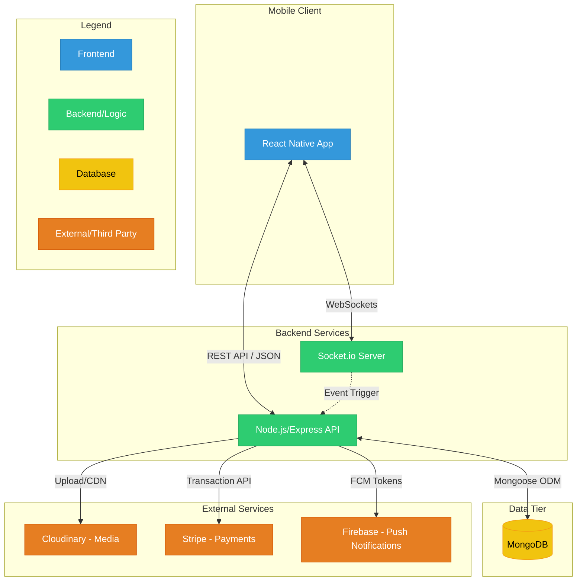

# Architecture & Data Flow

**Technical Architecture and System Design Documentation**

*Understanding how Diora works under the hood*

---

## Overview

This document explains how Diora works internally - how data moves through the system, how different components communicate, and the technical decisions behind the platform's architecture.

## System Overview

Diora follows a modern client-server architecture with specialized external services:

| Component | Technology | Purpose |
|-----------|------------|---------|
| **Mobile App** | React Native 0.79.4 + Expo SDK 53 | User interface and interaction |
| **API Server** | Node.js + Express.js 5.1.0 | Business logic and data processing |
| **Database** | MongoDB 6.17.0 + Mongoose 8.16.2 | Data persistence and relationships |
| **Real-time** | Socket.io 4.8.1 | Live messaging and notifications |
| **Images** | Cloudinary | Image storage and optimization |
| **Payments** | Stripe | Secure payment processing |
| **Notifications** | Firebase | Push notifications |

## Database Organization

The MongoDB database is organized into collections that reflect the app's core functionality:

### Core Collections

- **Users Collection**: User profiles, authentication data, preferences, and shop information
- **Posts Collection**: Outfit posts with images, captions, and engagement metrics
- **Products Collection**: Shop inventory with pricing, descriptions, and category information
- **Orders Collection**: Purchase records with customer, product, and payment details
- **Messages Collection**: Chat history with timestamps, reactions, and delivery status
- **Conversations Collection**: Group and direct message metadata with participant management

### Supporting Collections

- **Notifications Collection**: User notifications with read status and auto-cleanup (30+ days)
- **Reviews Collection**: Product and shop reviews with ratings and user feedback
- **Reports Collection**: Content moderation reports and administrative actions
- **Carts Collection**: Shopping cart items with quantity and variant information
- **Wishlists Collection**: Saved products for future purchase consideration
- **Promotion Requests Collection**: Shop promotion applications with document verification

## How Data Flows Through The System

### User Authentication Flow
1. User enters credentials in the mobile app
2. App calls `authService.login()` with email/password
3. Backend validates credentials against Users collection
4. If valid, backend generates JWT token with user information
5. App stores token securely and uses for subsequent requests
6. User is navigated to main application interface

### Social Posting Workflow
1. User selects photo and writes caption in post creation screen
2. App uploads image to Cloudinary and receives optimized URL
3. App calls `postService.createPost()` with caption and image URL
4. Backend creates post record in Posts collection
5. Backend notifies followers through Socket.io real-time connections
6. New post appears in followers' feeds immediately

### Shopping and Purchase Flow
1. User browses products through `productService.getProducts()`
2. Backend queries Products collection with filters and pagination
3. User adds items to cart via `cartService.addToCart()`
4. Backend updates user's cart in Carts collection
5. During checkout, backend creates Stripe payment session
6. Upon successful payment, order is created in Orders collection
7. Shop owner and customer receive notifications
8. Order status can be tracked and updated through order management

### Real-time Messaging System
1. User types message and submits through message interface
2. App sends message via Socket.io connection to backend
3. Backend saves message to Messages collection
4. If recipient is online, message delivered instantly via Socket.io
5. If recipient is offline, message queued for delivery when they reconnect
6. Message history synchronized across all user devices

### Content Moderation Process
1. User reports inappropriate content through report interface
2. Frontend calls `reportService.submitReport()` with details
3. Backend creates report record in Reports collection
4. Admin receives notification about new report
5. Admin reviews content and takes appropriate action
6. System can hide content, warn users, or escalate based on severity

## Technical Implementation Details

### Frontend Architecture Patterns

#### Component-Service Pattern
UI components focus solely on presentation and user interaction. All data fetching and API communication is handled by dedicated service modules, creating clean separation between UI and business logic.

#### Hook-Based State Management
Custom React hooks encapsulate complex state logic and side effects. This pattern makes components simpler while providing reusable state management across the application.

#### Type-Safe Development
TypeScript ensures data consistency between frontend and backend. Interface definitions catch errors during development and provide better developer experience with autocomplete and validation.

### Backend Architecture Patterns

#### MVC (Model-View-Controller)
- **Models**: MongoDB schemas with Mongoose define data structure and validation
- **Views**: JSON API responses formatted for frontend consumption
- **Controllers**: Business logic that processes requests and coordinates responses

#### Middleware Pipeline
Each API request flows through a series of middleware functions:
1. **Rate Limiting**: Prevents abuse with configurable request limits
2. **Authentication**: JWT token validation and user identification
3. **Authorization**: Role-based access control (user/shop/admin)
4. **Validation**: Request data sanitization and validation
5. **Business Logic**: Core functionality in controller methods
6. **Response**: Standardized JSON response formatting

#### Database Design Principles
- **Indexing**: Strategic indexes on frequently queried fields
- **Relationships**: Balanced use of references vs embedded documents
- **Performance**: Optimized queries using MongoDB aggregation pipelines

## Real-time Communication

### WebSocket Architecture
Socket.io maintains persistent connections between user devices and the server, enabling instant bidirectional communication without the overhead of repeated HTTP requests.

#### Connection Management
- **User Registration**: Clients register with user ID for targeted messaging
- **Room Management**: Users join conversation rooms for group messaging
- **Presence Tracking**: Online/offline status automatically managed
- **Reconnection**: Automatic reconnection handling for network interruptions

#### Event Types
**Client to Server Events:**
- `register`: Associate connection with user account
- `join_conversation`: Subscribe to conversation updates
- `typing_start`/`typing_stop`: Typing indicator management

**Server to Client Events:**
- `message`: New message delivery
- `notification`: Real-time notifications
- `user_online`/`user_offline`: Presence updates
- `typing`: Typing indicators from other users

## External Service Integration

### Payment Processing (Stripe)
- **Security**: Stripe handles all payment data and PCI compliance
- **Flow**: Order → Stripe session → Payment → Webhook confirmation → Order update
- **Features**: Support for multiple payment methods, subscription billing, refunds

### Image Management (Cloudinary)
- **Processing**: Automatic image optimization, resizing, and format conversion
- **Delivery**: Global CDN ensures fast image loading worldwide
- **Storage**: Unlimited scalable storage with automatic backup

### Push Notifications (Firebase)
- **Delivery**: Notifications sent to user devices even when app is closed
- **Targeting**: User-specific notification preferences and device management
- **Types**: New messages, order updates, social interactions, promotions

## Security Architecture

### Authentication & Authorization
- **JWT Tokens**: Stateless authentication with user role information
- **Password Security**: bcrypt hashing with salt for password storage
- **Session Management**: Token expiration and refresh token handling
- **Role-Based Access**: Different permission levels for users, shops, and admins

### Data Protection
- **Input Validation**: All user input sanitized to prevent injection attacks
- **Rate Limiting**: API endpoints protected against abuse and DDoS
- **CORS Protection**: Cross-origin requests properly controlled
- **HTTPS Encryption**: All data transmission encrypted in transit

### Content Moderation
- **Automated Detection**: Basic content filtering for obvious violations
- **Manual Review**: Admin tools for investigating reported content
- **Action Tracking**: Complete audit trail of moderation decisions
- **Appeal Process**: Users can contest moderation actions

## Performance & Scalability

### Database Optimization
- **Indexing Strategy**: Compound indexes for complex queries
- **Query Optimization**: Aggregation pipelines for efficient data processing
- **Connection Pooling**: Optimized database connection management
- **Data Archiving**: Automatic cleanup of old notifications and resolved reports

### Caching Strategy
- **Image Caching**: Cloudinary CDN provides global image distribution
- **API Caching**: Frequently accessed data cached to reduce database load
- **Real-time Optimization**: Socket.io rooms minimize unnecessary message broadcasting

### Error Handling & Recovery
- **Graceful Degradation**: App functionality maintained during service outages
- **Circuit Breakers**: Automatic failure detection and recovery for external services
- **Comprehensive Logging**: Detailed error tracking and performance monitoring
- **Health Checks**: Automated system health monitoring and alerting

## Administrative Features

### Platform Management
- **Real-time Analytics**: User engagement, order metrics, and growth tracking
- **User Management**: Search, suspend, ban, and communication tools
- **Content Oversight**: Post and product visibility controls
- **Shop Promotion**: Document verification and business validation process

### Automated Maintenance
- **Data Cleanup**: Automatic removal of old notifications and temporary data
- **Performance Monitoring**: Continuous tracking of system performance metrics
- **Security Scanning**: Regular checks for potential security vulnerabilities
- **Backup Management**: Automated database backups with point-in-time recovery

---

> **Related Documentation:**
> - [Project Structure](structure.md) - Detailed codebase organization and file locations
> - [API Documentation](api.md) - Complete endpoint specifications and examples
> - [Setup Guide](setup.md) - Development environment configuration
