# Feature Showcase

**Visual Tour of Diora's Key Features and User Interfaces**

*Explore what makes Diora the ultimate fashion platform*

---

## Overview

A visual tour of Diora's key features and user interfaces for fashion enthusiasts, shoppers, and retailers. This showcase demonstrates the platform's capabilities across different user types and use cases.

Navigation & Getting Started

### Authentication
<table align="center">
<tr>
<th><b>Login</b></th>
<th><b>Sign Up</b></th>
</tr>
<tr>
<td>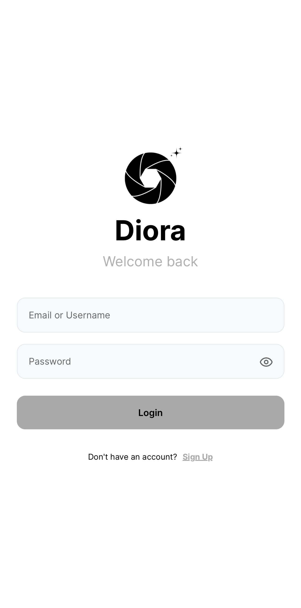</td>
<td>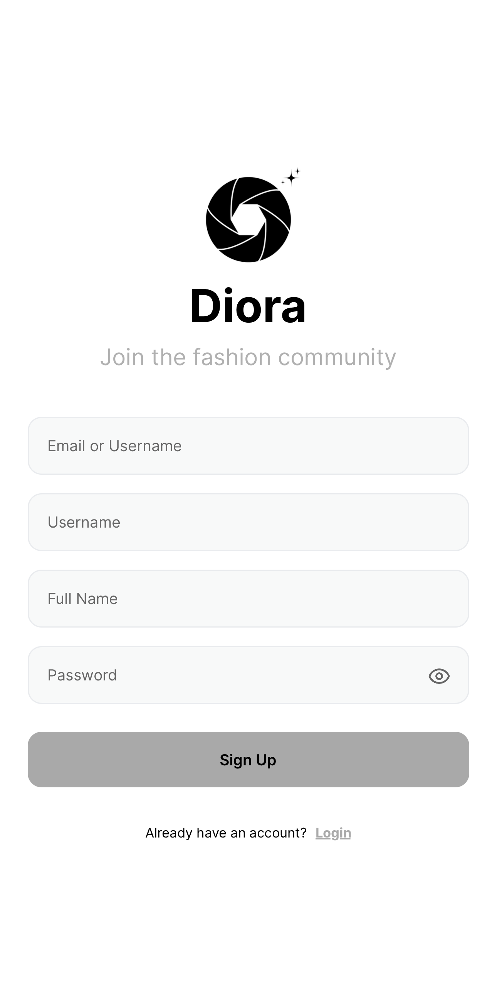</td>
</tr>
<tr>
<td><small><i>Fig 1.1: Login Screen</i></small></td>
<td><small><i>Fig 1.2: Sign Up Screen</i></small></td>
</tr>
</table>

Secure user access:
- Email/password authentication
- Account recovery options

Social Features

### Home Feed
<table align="center">
<tr>
<th><b>Home Feed</b></th>
<th><b>Explore Page 1</b></th>
<th><b>Explore Page 2</b></th>
</tr>
<tr>
<td>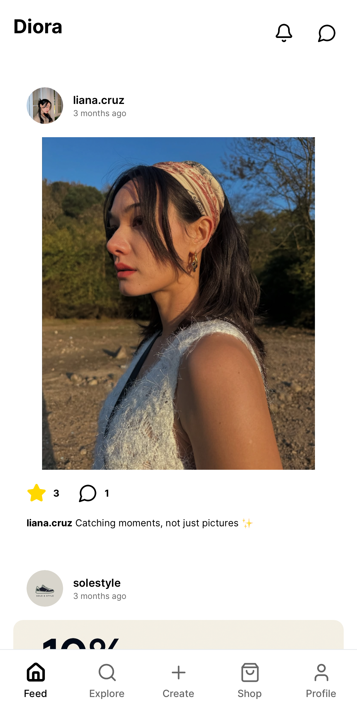</td>
<td>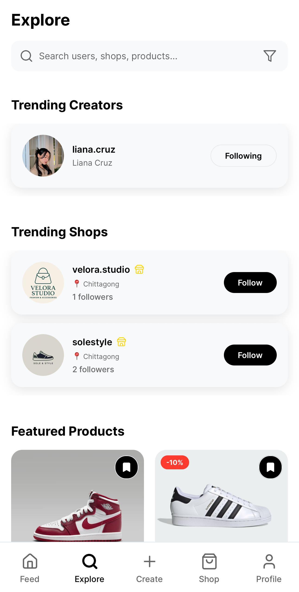</td>
<td>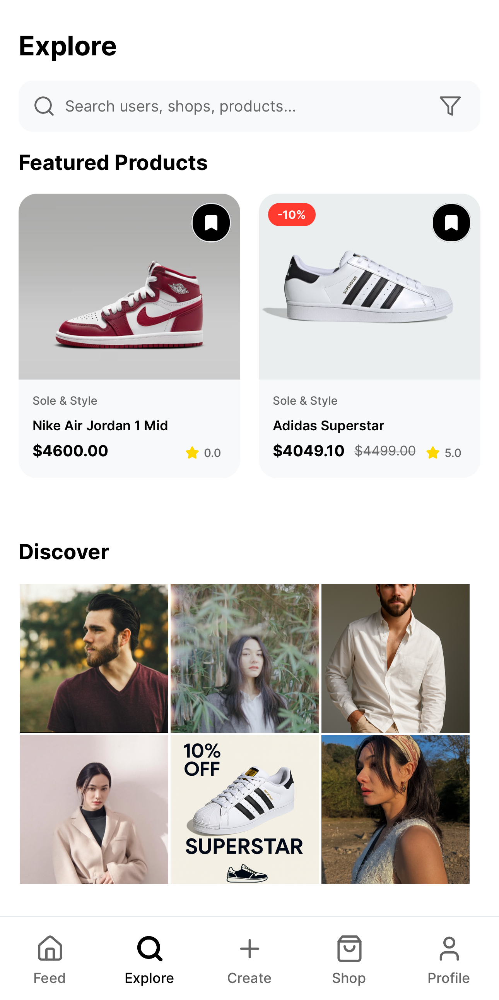</td>
</tr>
<tr>
<td><small><i>Fig 2.1: Home Feed</i></small></td>
<td><small><i>Fig 2.2: Explore Page 1</i></small></td>
<td><small><i>Fig 2.3: Explore Page 2</i></small></td>
</tr>
</table>

The main Feed tab where users discover fashion inspiration:
- Scroll through a curated feed of outfit posts from followed users and trending content
- Like and comment on posts that inspire them
- Follow users whose style they admire
- Get real-time updates from followed accounts

### Content Creation
<table align="center">
<tr>
<th><b>Post Creation Screen 1</b></th>
<th><b>Post Creation Screen 2</b></th>
</tr>
<tr>
<td>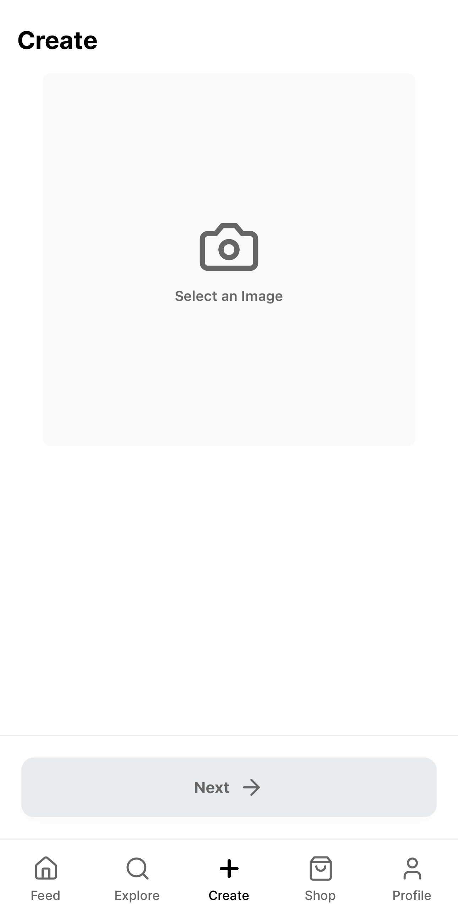</td>
<td>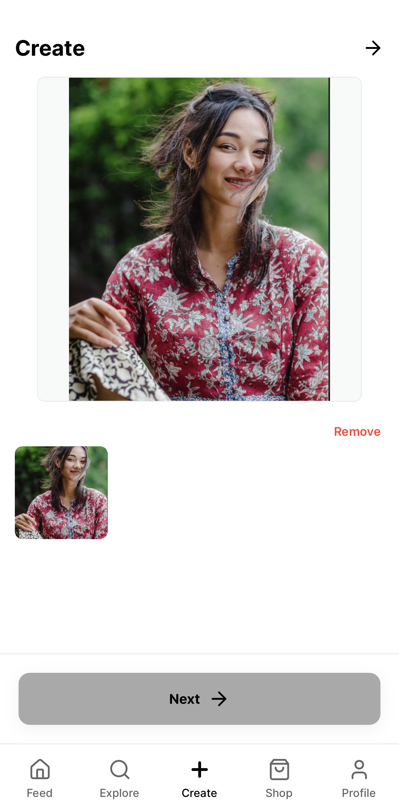</td>
</tr>
<tr>
<td><small><i>Fig 2.4: Post Creation Screen 1</i></small></td>
<td><small><i>Fig 2.5: Post Creation Screen 2</i></small></td>
</tr>
</table>

Users can share their fashion choices with the community:
- Upload outfit photos from camera or gallery
- Add detailed captions with styling tips and hashtags

### Post Details & Interactions
<table align="center">
<tr>
<th><b>Individual Post View</b></th>
<th><b>Comments Section</b></th>
<th><b>Liked Post</b></th>
</tr>
<tr>
<td>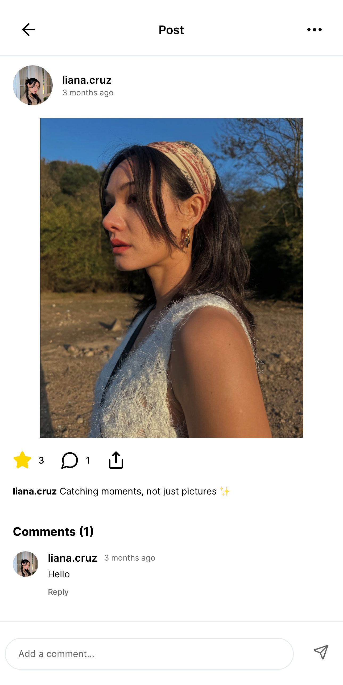</td>
<td>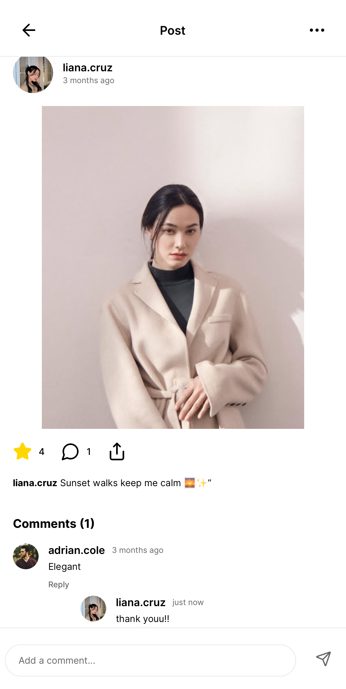</td>
<td></td>
</tr>
<tr>
<td><small><i>Fig 2.6: Individual Post View</i></small></td>
<td><small><i>Fig 2.7: Comments Section</i></small></td>
<td><small><i>Fig 2.8: Liked Post</i></small></td>
</tr>
</table>

Detailed post viewing and interaction:
- Complete caption and styling details
- Nested comment system with threading
- User mentions and hashtag linking
- Report inappropriate content options

User Profiles & Social Networking

### User Profiles
<table align="center">
<tr>
<th><b>User Profile</b></th>
<th><b>Other User Profile</b></th>
<th><b>Profile Edit Screen</b></th>
</tr>
<tr>
<td></td>
<td></td>
<td>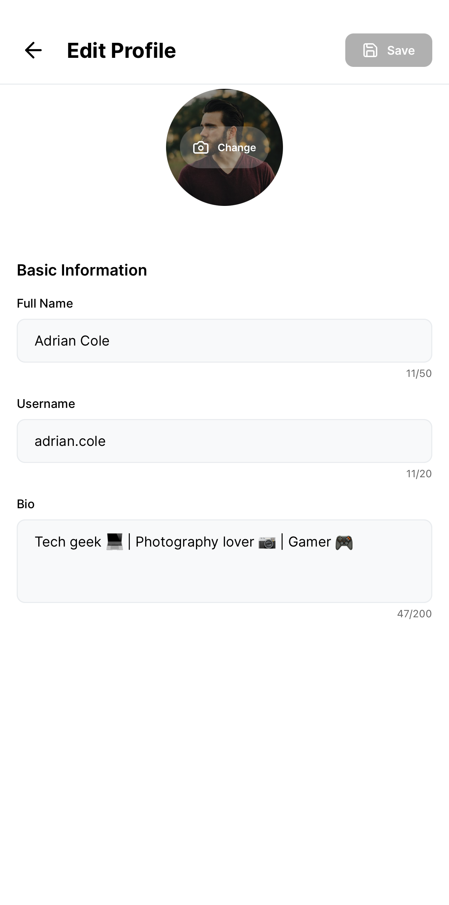</td>
</tr>
<tr>
<td><small><i>Fig 3.1: User Profile</i></small></td>
<td><small><i>Fig 3.2: Other User Profile</i></small></td>
<td><small><i>Fig 3.3: Profile Edit Screen</i></small></td>
</tr>
</table>

Personal style showcases and user information:
- Display user's posted outfits in a grid layout
- Show follower and following statistics
- Personal bio and style preferences
- Follow/unfollow functionality
- Direct messaging access

Find and connect with fashion enthusiasts:
- Search users by username
- Filter by location, style categories, and activity
- Trending users based on engagement metrics
- Follow suggestions based on interests

E-Commerce & Shopping

### Product Catalog
<table align="center">
<tr>
<th><b>Product Catalog</b></th>
</tr>
<tr>
<td>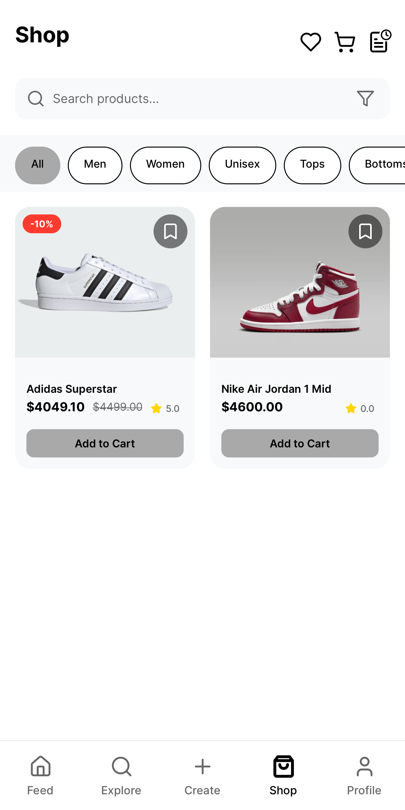</td>
</tr>
<tr>
<td><small><i>Fig 4.1: Product Catalog</i></small></td>
</tr>
</table>

Browse and discover fashion products:
- Curated fashion products from verified retailers
- Filter by categories, price, and popularity
- Search products by name or brand
- Add items to wishlist for later consideration

### Product Page
<table align="center">
<tr>
<th><b>Product Page</b></th>
</tr>
<tr>
<td>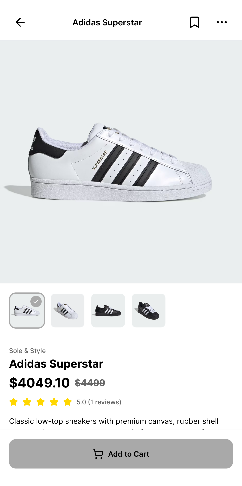</td>
<td></td>
<td>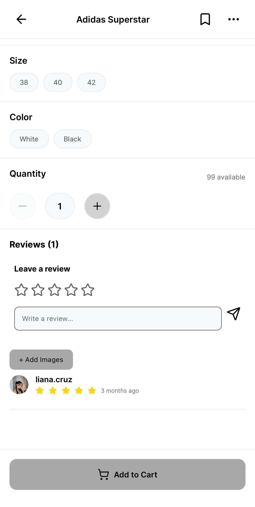</td>
</tr>
<tr>
<td><small><i>Fig 4.2: Product Page 1</i></small></td>
<td><small><i>Fig 4.3: Product Page 2</i></small></td>
<td><small><i>Fig 4.4: Product Page 3</i></small></td>
</tr>
</table>

Comprehensive product information:
- High-quality product images
- Detailed descriptions and specifications
- Size and color selection options
- Customer reviews and ratings
- Add to cart and wishlist functionality

### Shopping Cart & Checkout
<table align="center">
<tr>
<th><b>Shopping Cart</b></th>
<th><b>Checkout Page</b></th>
<th><b>Stripe Payment Gateway</b></th>
</tr>
<tr>
<td>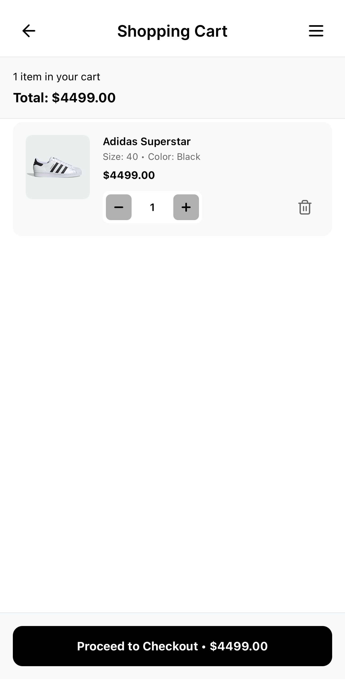</td>
<td>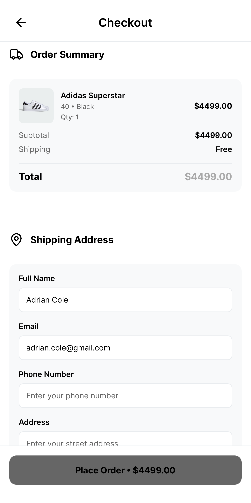</td>
<td>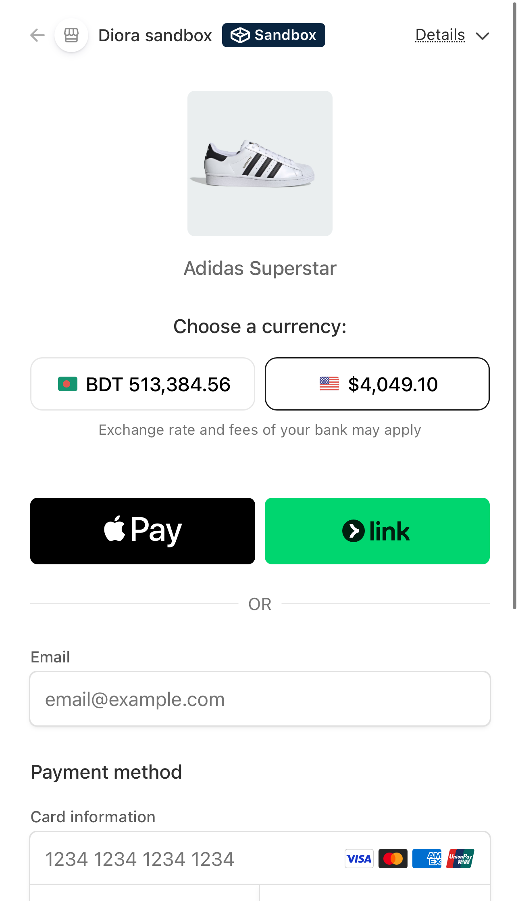</td>
</tr>
<tr>
<td><small><i>Fig 4.5: Shopping Cart</i></small></td>
<td><small><i>Fig 4.6: Checkout Page</i></small></td>
<td><small><i>Fig 4.7: Stripe Payment Gateway</i></small></td>
</tr>
</table>

Streamlined purchasing experience:
- Review selected items with quantity adjustment
- Secure address and payment information entry
- Multiple payment methods such as credit card via Stripe, Bkash and Cash on Delivery
- Order confirmation with tracking details

### Order History & Tracking
<table align="center">
<tr>
<th><b>Order History Screen</b></th>
<th><b>Order Details</b></th>
</tr>
<tr>
<td>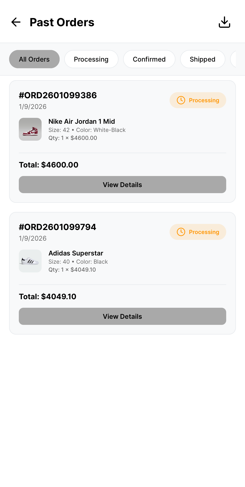</td>
<td>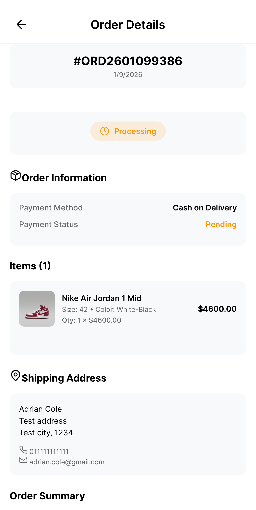</td>
</tr>
<tr>
<td><small><i>Fig 4.8: Order History Screen</i></small></td>
<td><small><i>Fig 4.9: Order Details</i></small></td>
</tr>
</table>

Complete order lifecycle management:
- Order history with filtering for processed, shipped, and delivered orders
- Detailed order information and receipts
- Order Cancellation and return options

Shop Owner Features

### Shop Management
<table align="center">
<tr>
<th><b>Shop Dashboard</b></th>
<th><b>Shop Profile</b></th>
<th><b>Shop Order List</b></th>
</tr>
<tr>
<td>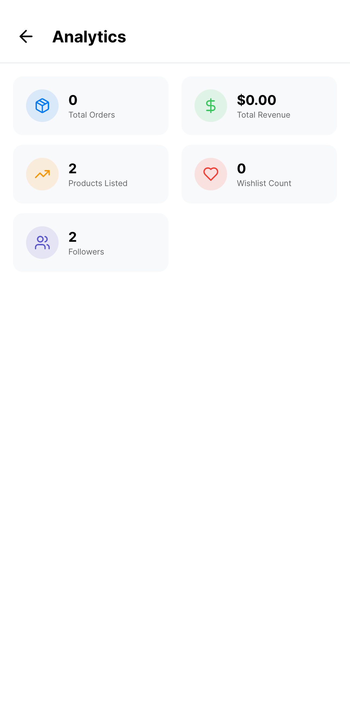</td>
<td>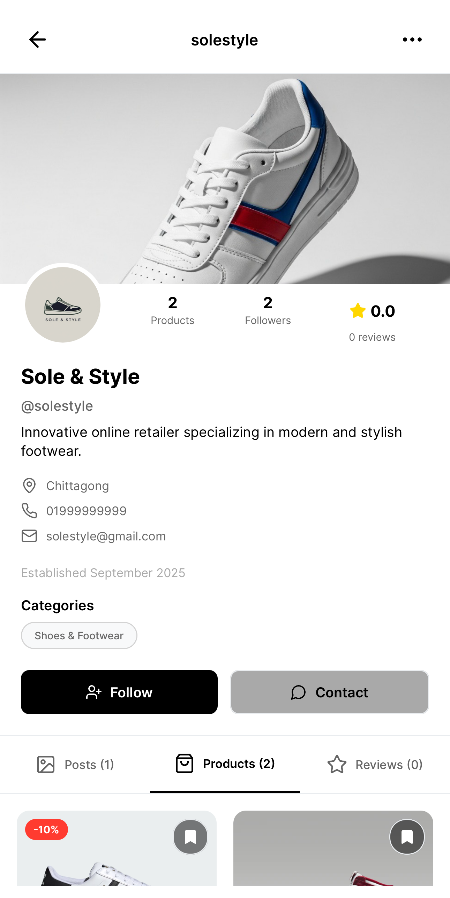</td>
<td>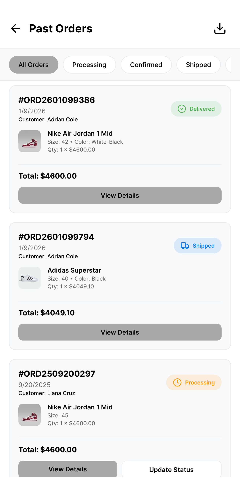</td>
</tr>
<tr>
<td><small><i>Fig 5.1: Shop Dashboard</i></small></td>
<td><small><i>Fig 5.2: Shop Profile</i></small></td>
<td><small><i>Fig 5.3: Shop Order List</i></small></td>
</tr>
</table>

### Shop Promotion
<table align="center">
<tr>
<th><b>Shop Promotion Request Modal</b></th>
</tr>
<tr>
<td>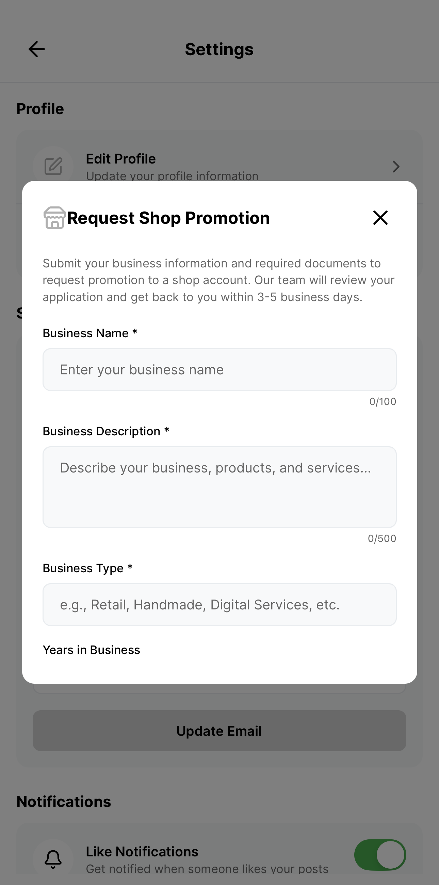</td>
</tr>
<tr>
<td><small><i>Fig 5.4: Shop Promotion Request Modal</i></small></td>
</tr>
</table>

### Product Creation
<table align="center">
<tr>
<th><b>Product Creation Screen 1</b></th>
<th><b>Product Creation Screen 2</b></th>
</tr>
<tr>
<td>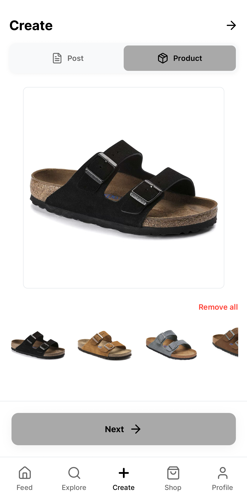</td>
<td>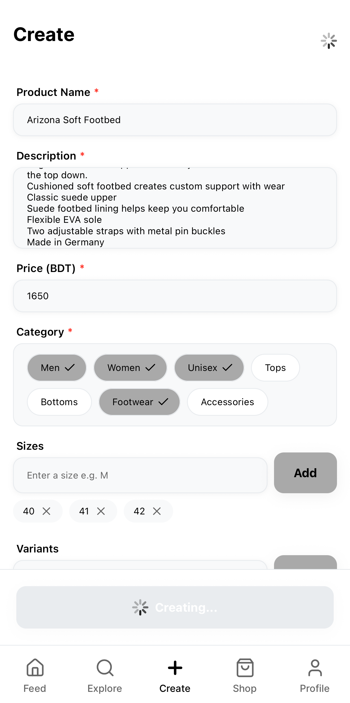</td>
</tr>
<tr>
<td><small><i>Fig 5.5: Product Creation Screen 1</i></small></td>
<td><small><i>Fig 5.6: Product Creation Screen 2</i></small></td>
</tr>
</table>

Comprehensive tools for fashion retailers:
- Create and manage branded shop profiles
- Upload and organize product catalogs
- Track sales analytics and performance metrics
- Manage orders and inventory
- Communicate directly with customers

Real-Time Messaging

### Direct Messaging
<table align="center">
<tr>
<th><b>Conversation List</b></th>
<th><b>Chat Interface</b></th>
</tr>
<tr>
<td></td>
<td></td>
</tr>
<tr>
<td><small><i>Fig 6.1: Conversation List</i></small></td>
<td><small><i>Fig 6.2: Chat Interface</i></small></td>
</tr>
</table>

Instant messaging capabilities throughout the platform:
- Direct messaging between users
- Group conversations for style discussions
- Message reactions and media sharing
- Push notifications for immediate updates

Administrative Panel

### Platform Management
<table align="center">
<tr>
<th><b>Admin Analytics</b></th>
<th><b>Admin Profile</b></th>
</tr>
<tr>
<td>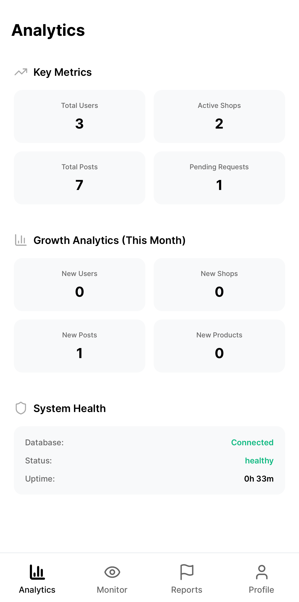</td>
<td>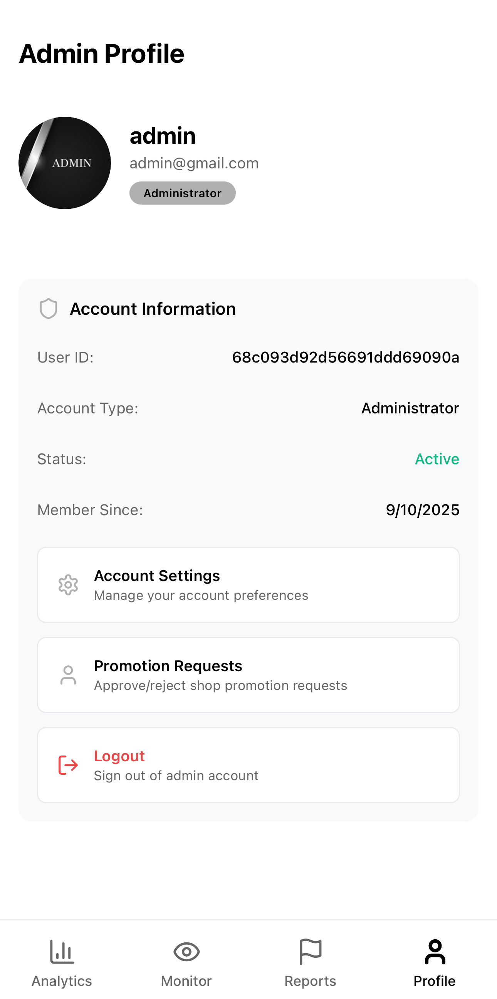</td>
</tr>
<tr>
<td><small><i>Fig 7.1: Admin Analytics</i></small></td>
<td><small><i>Fig 7.2: Admin Profile</i></small></td>
</tr>
</table>

### Content Moderation
<table align="center">
<tr>
<th><b>User Monitoring</b></th>
<th><b>Post Monitoring</b></th>
<th><b>Product Monitoring</b></th>

</tr>
<tr>
<td>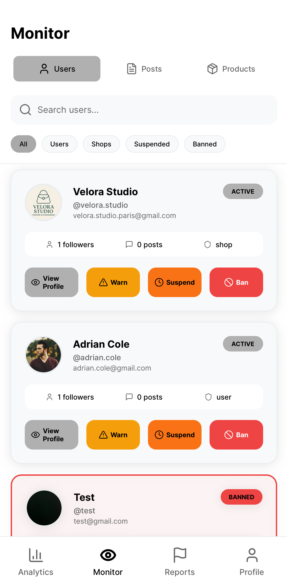</td>
<td>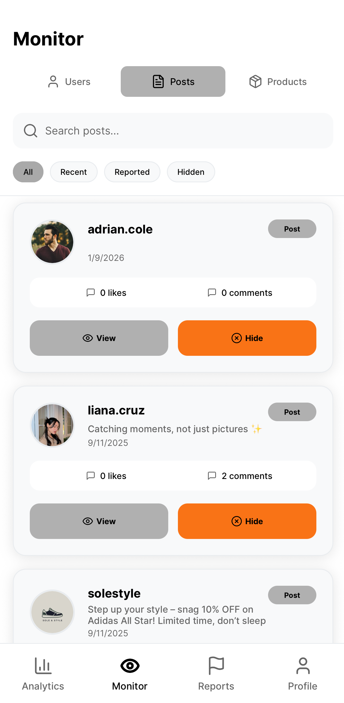</td>
<td>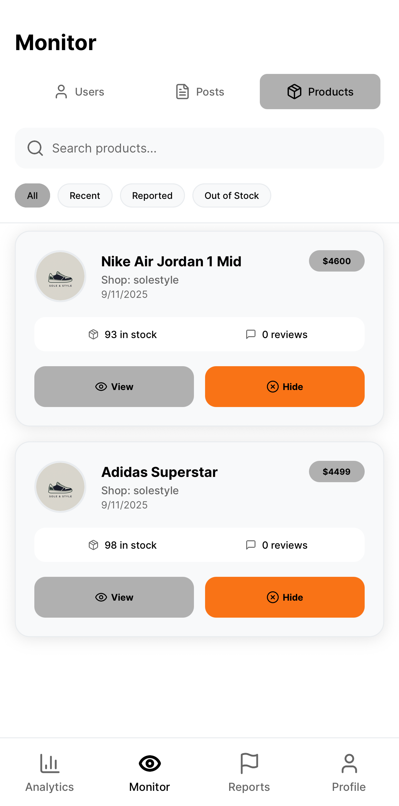</td>
</tr>
<tr>
<td><small><i>Fig 7.3: User Monitoring</i></small></td>
<td><small><i>Fig 7.4: Post Monitoring</i></small></td>
<td><small><i>Fig 7.5: Product Monitoring</i></small></td>
</tr>
</table>

<table align="center">
<tr>
<th><b>Admin Report Management</b></th>
<th><b>Report Detail 1</b></th>
<th><b>Report Detail 2</b></th>
</tr>
<tr>
<td></td>
<td>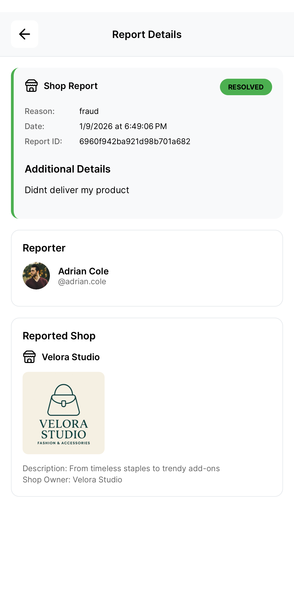</td>
<td>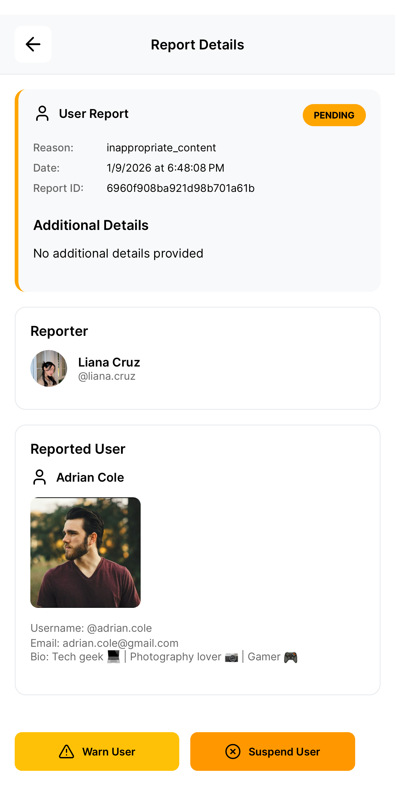</td>
</tr>
<tr>
<td><small><i>Fig 7.6: Admin Report Management</i></small></td>
<td><small><i>Fig 7.7: Report Detail 1</i></small></td>
<td><small><i>Fig 7.8: Report Detail 2</i></small></td>
</tr>
</table>

Platform management tools for administrators:
- Real-time platform statistics and user growth metrics
- User management (search, suspend, ban, warn users)
- Content moderation system (hide/show posts and products)
- Shop promotion request approval workflow
- System health monitoring and performance metrics

Search & Discovery

### Explore & Discovery
<table align="center">
<tr>
<th><b>Explore Interface</b></th>
</tr>
<tr>
<td>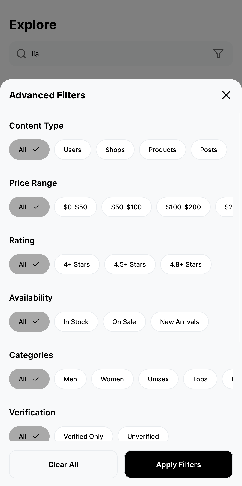</td>
</tr>
<tr>
<td><small><i>Fig 8.1: Explore Interface</i></small></td>
</tr>
</table>

Powerful Explore tab for search and discovery capabilities:
- Unified search across users, posts, and products
- Real-time search suggestions and autocomplete
- Advanced filters by category, location, and price
- Trending posts and popular fashion content
- Shop directory with ratings and reviews

Notifications & Activity Feed

### Notification Center
<table align="center">
<tr>
<th><b>Notifications List</b></th>
<th><b>Notification Settings</b></th>
</tr>
<tr>
<td>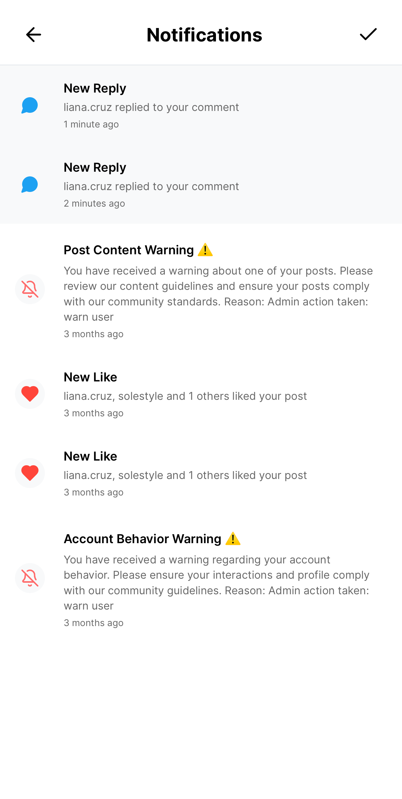</td>
<td>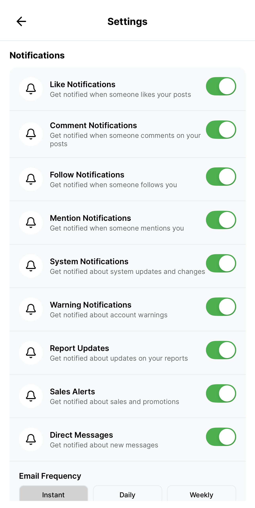</td>
</tr>
<tr>
<td><small><i>Fig 9.1: Notifications List</i></small></td>
<td><small><i>Fig 9.2: Notification Preference Setting</i></small></td>
</tr>
</table>

Stay updated with platform activity:
- Real-time push notifications via Firebase
- In-app notification center with activity history
- Customizable notification preferences and settings

Additional Features

### Dark Mode Theme
<table align="center">
<tr>
<th><b>Home Feed Dark Mode</b></th>
</tr>
<tr>
<td>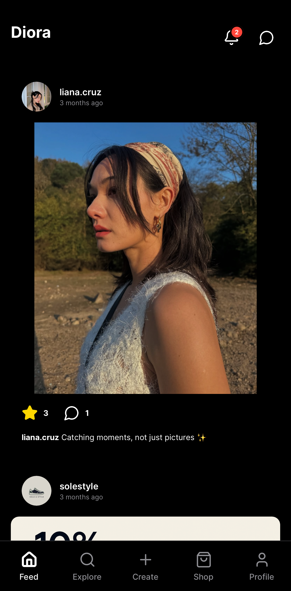</td>
</tr>
<tr>
<td><small><i>Fig 10.1: Home Feed Dark Mode</i></small></td>
</tr>
</table>

Accessibility and personalization:
- Complete dark theme implementation
- Consistent visual hierarchy in both themes
- Reduced eye strain for low-light usage
- User preference storage and automatic switching

### Wishlist Management
<table align="center">
<tr>
<th><b>Wishlist Screen</b></th>
</tr>
<tr>
<td>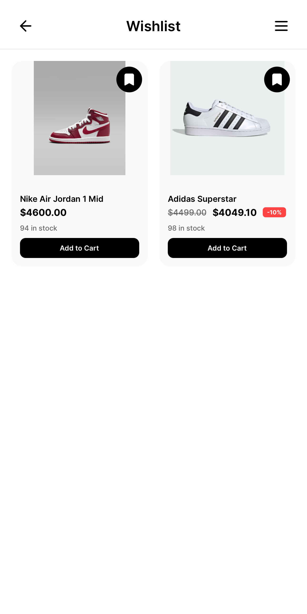</td>
</tr>
<tr>
<td><small><i>Fig 10.2: Wishlist Screen</i></small></td>
</tr>
</table>

Save items for future consideration:
- Bookmark icon to save products from anywhere in the app
- Organized wishlist with product details
- Quick add to cart from wishlist

### Settings
<table align="center">
<tr>
<th><b>Settings Screen</b></th>
</tr>
<tr>
<td>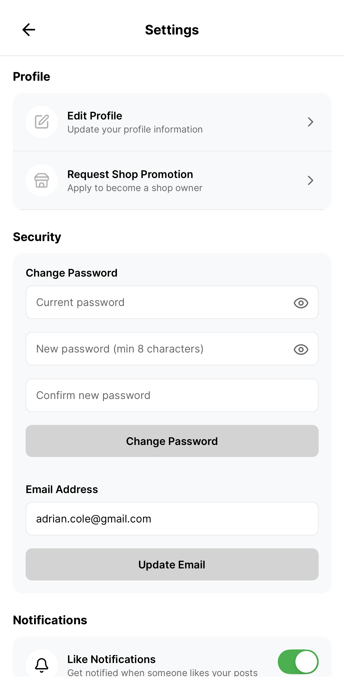</td>
</tr>
<tr>
<td><small><i>Fig 10.3: Settings Screen</i></small></td>
</tr>
</table>

App settings and preferences:
- Account settings and privacy options
- Notification preferences
- Theme selection (light/dark mode)
- Language and region settings
- Help and support access

---

## Project Overview & Architecture

### Complete Feature Ecosystem
Diora represents a comprehensive fashion technology platform that seamlessly integrates:

**Social Fashion Community:**
- Content creation and sharing
- User profiles and social networking
- Real-time messaging and collaboration
- Content discovery and trending
- Community moderation and safety

**E-Commerce Platform:**
- Product catalog and inventory management
- Secure checkout and payment processing
- Order fulfillment and tracking
- Shop management and analytics
- Customer service and support

This showcase demonstrates Diora's comprehensive approach to combining social fashion sharing with practical shopping solutions, creating a complete ecosystem for fashion enthusiasts and retailers alike.
